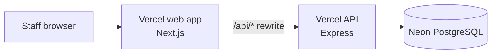
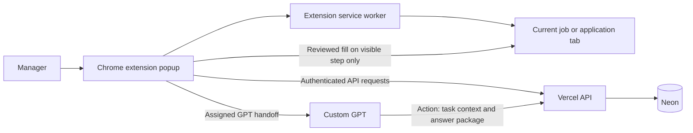
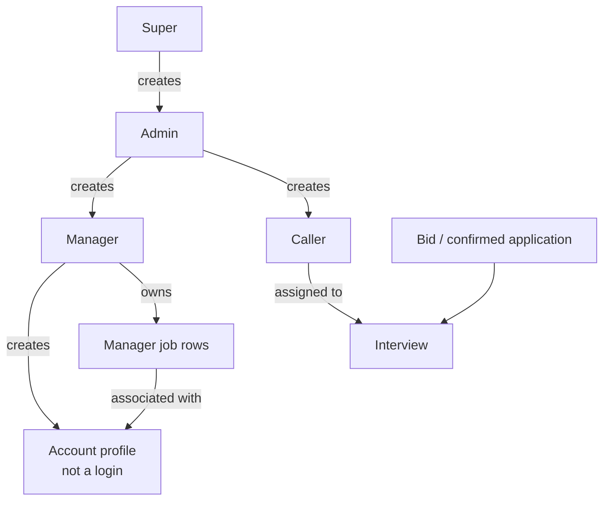
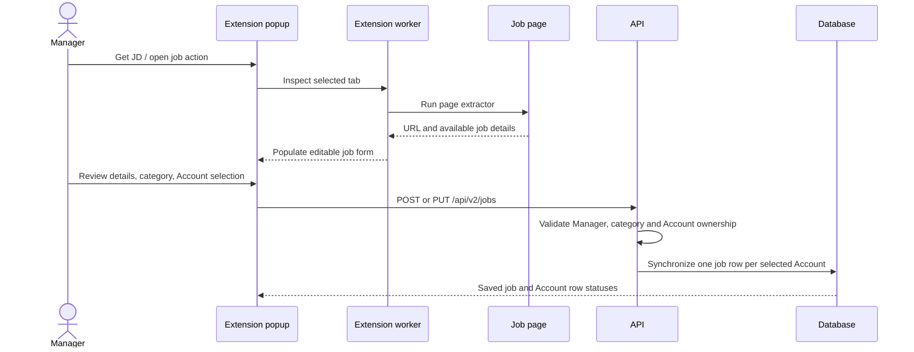
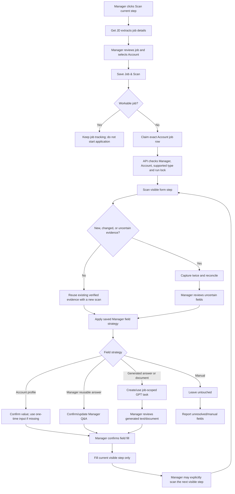
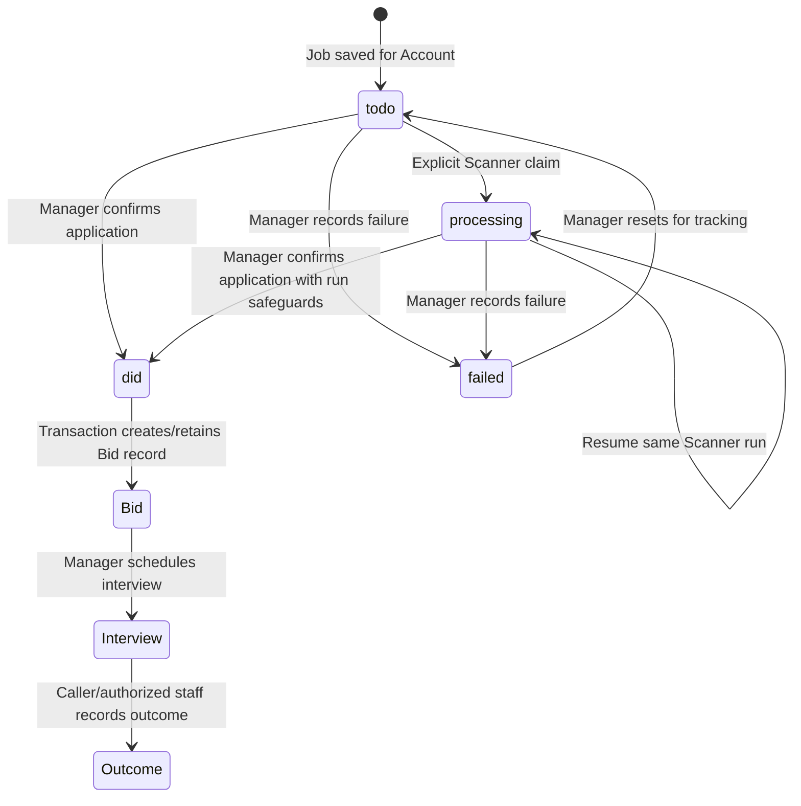
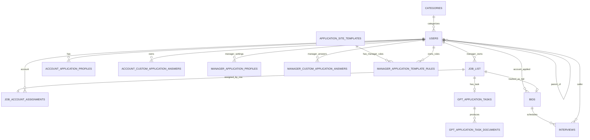

# QTS Project Features and End-to-End Flow

- **Analysis date:** 2026-10-12
- **Scope:** The project files and working tree in this checkout, not a live
  production audit.
- **Purpose:** Explain what the product does, how its parts connect, and which
  older-looking pieces are retired, supporting, or potentially stale.

> **Important deployment distinction:** At the time of this analysis, local
> `main` was 23 commits ahead of `origin/main` and had substantial uncommitted
> and untracked work. This guide describes the current intended behavior
> visible in the working tree and [the current-system guide](CURRENT-SYSTEM.md).
> It does not prove that every described behavior is in GitHub or Vercel
> production. Vercel deploys the web app and API; the Chrome extension is a
> separate deliverable.

## 1. Executive summary

QTS is a team job-tracking application with a separate Chrome extension for
capturing job details and providing tightly controlled application-form
assistance.

Its main current product loop is:

1. Staff users sign in to the web app. Managers create candidate-like **Account
   profiles**; these profiles are data records, not login users.
2. A Manager captures job details, associates a job with one or more Accounts,
   and reviews each Account's separate job row.
3. On supported, non-Workable application sites, a Manager can explicitly run
   Scanner for one Account and one visible form step.
4. Scanner observes the form, asks the Manager to decide how fields should be
   handled, and may fill only confirmed fields on the current page.
5. Custom GPT may generate requested answers or documents for that job task;
   the Manager reviews those outputs before Scanner uses them.
6. QTS does **not** automatically move to another page or submit the
   application. The Manager records the outcome in the job-tracking workflow.
7. If an application is confirmed as submitted, the job moves into Bids, where
   Managers schedule interviews and Callers record interview outcomes.

Workable job capture and tracking remain supported. Workable form filling,
Workable application handling, and the Manager Apply queue are retired.

## 2. Architecture and product boundaries

### Production web/API path



`start.bat` opens the configured public site; it does not start the production
API or database. Local development and database scripts exist, but they are
not the public production request path.

### Extension and GPT path



The extension is not deployed by deploying the web/API projects. Updating the
extension means distributing or reloading the files in `extension/` separately.
The Custom GPT Action is an external integration, assigned by Super and
authorized to the API with a separate action key.

### Main code map

| Area | Main location | Responsibility |
|---|---|---|
| Web app | `admin-web/src/app/` | Login and role-specific pages |
| Shared web panels | `admin-web/src/components/` | Job, people, profile, interview, PDF, analytics, and admin views |
| Web API client | `admin-web/src/lib/api.ts` | Sends web requests to the API and includes the saved bearer token |
| API entry point | `server/src/app.ts` | Middleware, database readiness, route mounting, health endpoint |
| New-schema API | `server/src/modules/new-schema/` | Current auth, users, jobs, bids, interviews, settings, and manager workflows |
| Extension UI | `extension/popup/` | Manager sign-in, Get JD, job save, Scanner review and status |
| Extension service worker | `extension/background/service-worker.js` | Browser tab coordination, page script injection, API/GPT coordination |
| Page scanner | `extension/content/form-scan.js`, `application-discovery.js` | Observes visible form controls and page structure |
| Scanner evidence | `extension/shared/scanner-capture.js` | Reconciles observations and assesses locator stability |
| Database | `server/src/database/connection.ts` | Schema creation, migrations, cleanup and database access |
| Deployment | `DEPLOY.md`, Vercel config files | Separate web/API deployment instructions |
| Feature history | `logs/README.md` and dated `logs/` entries | Concise record of meaningful feature changes |

## 3. Roles, ownership, and access

### Staff hierarchy



The main staff roles are Super, Admin, Manager, and Caller. The `account` role
in the database denotes a candidate profile and does not authenticate. The API
enforces ownership and role scopes; hiding a web menu item is not the only
access-control boundary.

| Role | Main responsibilities in the current web app |
|---|---|
| **Super** | Create/manage Admins, maintain categories and global settings, assign Custom GPTs, inspect the protected database browser, review/promote application templates, view broad analytics |
| **Admin** | Manage their organization’s Managers and Callers, jobs, categories, interviews, and scoped analytics |
| **Manager** | Manage Account profiles, job rows, application answers, resume PDFs, bids, interviews, and explicit Scanner sessions |
| **Caller** | View assigned interviews and record the interview outcome/comment |
| **Account profile** | Stores one candidate's details, education/work history, resume and reusable Q&A; does not sign in |

### Authentication flow

1. The browser sends username/password to `POST /api/v2/auth/login`.
2. The API rejects Account profiles, blocked users or blocked ancestors,
   invalid credentials, and users without a password.
3. The API returns a signed JWT marked for the current new schema.
4. The web client stores the token in browser `localStorage`; authenticated
   requests send it as a bearer token.
5. Panel startup calls `/api/v2/auth/me`, checks the user's role and redirects
   to the matching role area.
6. Protected API routes re-verify the token and load the current user/ownership
   state from the database.
7. Staff users must change temporary passwords when required. Logout clears the
   client token.

## 4. Feature category: people, categories, and Account profiles

### Organization and profiles

- Super creates Admin users; Admins create Managers and Callers; Managers
  create Account profiles.
- Account profiles are linked to a Manager and a category.
- A profile can contain contact details, education, work experience,
  structured custom fields, custom application answers, and a stored resume
  PDF.
- Resume content is stored on the server/database profile; the API can expose
  whether a resume exists and its filename without treating the binary as
  ordinary profile text.
- Manager-owned reusable application answers are separate from each Account's
  own custom answers. Account-specific answers are intended to take precedence
  for that Account.
- The API validates role and parent ownership before allowing profile
  operations. Admin/Super management of staff is not the same permission as
  reading Manager-owned answer content.

### Categories

Categories connect Manager jobs to candidate profiles:

1. Staff with the appropriate role maintain category records.
2. Each Account profile has one category.
3. A Manager associates a job with one or more categories.
4. The Manager chooses the Accounts assigned to the job; the API verifies
   ownership, active status, and category compatibility.

## 5. Feature category: job capture, assignment, and tracking

### Capture and save

The extension's **Get JD** flow uses the current browser tab to identify the
job URL and extract available job information, such as title, company, and
description. Generic and site-specific extractors are used where available.
The Manager can review or edit extracted values before saving.



The web UI also manages and tracks jobs. Jobs are not one shared status record
for all candidate profiles: a job URL can correspond to several separate
Account-specific `job_list` rows, each linked by `job_account_assignments`.

When a Manager edits the Account selection:

- Existing `todo` rows for removed Accounts can be deleted.
- Rows with history/status beyond `todo` are retained; the UI/API reports when
  a selected Account cannot be removed without discarding that history.
- The job row records states such as `todo`, `processing`, `did`, or `failed`.

### Manual job tracking

The Manager Jobs page supports search and review of per-Account statuses.
Managers can reset certain failed rows to `todo`, delete a row, or manually
confirm that an application was submitted. Marking a row `did` moves the
application into Bids; it is a user-recorded outcome, not proof that a website
submission took place.

The `workable` application type is inferred from Workable job URLs. That type
is retained for capture, job list display, status tracking, and manual status
updates, but is filtered out of application claim/context/GPT-task paths.

## 6. Feature category: Manager Scanner (explicit, bounded application assist)

Scanner is not the retired Manager Apply queue. A Manager explicitly starts it
for a chosen Account and the currently visible application page.

### End-to-end Scanner flow



### Start and claim safety

1. Scanner requests Get JD extraction and presents the job form for Manager
   review.
2. The Manager selects an owned Account and clicks **Save Job & Scan**.
3. The extension saves or updates the job row and verifies that the response
   contains the selected Account's exact row.
4. For non-Workable application types, the extension generates a run UUID and
   calls the Manager-only claim endpoint for that job ID, Account ID, and
   supported type.
5. The API transaction validates ownership and active status, excludes
   Workable, prevents competing active rows/runs, and sets the selected row to
   `processing`. A later scan can resume the same run when its identifier is
   present.
6. Scanner refuses to start a Workable row. The job can remain saved for
   tracking, but it is not an application task.

### Field observation and fill boundaries

- The extension injects scanning scripts into the active page when needed.
- The scanner observes visible controls, labels, options, required status,
  step/section details, and bounded locator/DOM structure.
- On a new or uncertain step, two observations are reconciled. Changed,
  conflicting, missing, or ambiguous evidence is surfaced for Manager review.
- Existing verified fields can use one observation when the step is unchanged;
  meaningful changes trigger another verification.
- Class names are weak hints; class names alone do not establish field
  identity.
- Discovery checkpoints store structure and field mappings, not values typed
  into the form.
- A matched field may be filled only after the relevant Manager choice and
  confirmation. Existing values trigger an overwrite confirmation.
- Uncertain fields and manual-only fields remain untouched.
- Scanner operates on the current visible step. It does not click Next,
  navigate, or submit the final application.

### Answer strategies

| Strategy | Source/behavior | Persistence |
|---|---|---|
| **Profile** | Choose a value from the selected Account's profile. If missing, the Manager may enter a value for this application only. | Profile mapping is Manager/template-specific; one-time missing value is not saved to the Account or reusable answers. |
| **Reusable** | Confirm or enter a Manager-owned reusable answer for the semantic question. | Stored in the Manager's reusable Q&A and linked to a field rule. |
| **Generated** | Send selected fields and job description to the assigned Custom GPT for job-specific output. | Stored on the job-scoped GPT task; not added to reusable answers or Account profile. |
| **Manual** | Leave the field for the Manager to complete outside Scanner. | A strategy may be stored; Scanner does not fill it. |

Sensitive or candidate-specific matters should use the selected Account's
confirmed data or explicit Manager input, not a guessed global value. See
[CURRENT-SYSTEM.md](CURRENT-SYSTEM.md) for the current restrictions and field
handling contract.

## 7. Feature category: Custom GPT tasks and generated documents

Custom GPT is used as a reviewed, job-scoped assistant in Scanner. It is not an
unrestricted application submitter.

### Task and response lifecycle

```mermaid
sequenceDiagram
    actor M as Manager
    participant E as Extension
    participant A as QTS API
    participant G as Assigned Custom GPT
    participant D as Task storage

    M->>E: Scan and choose generated fields/documents
    E->>A: Create task for exact processing job row
    A->>A: Reject non-Manager, non-processing, or Workable job
    A->>A: Build scoped context from job + Account + Manager answers
    A->>D: Save/reuse job-scoped task and resume text if available
    E->>A: Set current page, fields, and job description
    E->>G: Hand off task prompt to assigned GPT
    G->>A: Action GET task context (action key)
    A-->>G: Job description, scoped profile, previous answers, fields
    G->>A: Action POST answer/document package
    A->>D: Validate fields, save package and task-scoped documents
    E->>A: Poll task status / retrieve approved task output
    A-->>E: Generated answers or document bytes
    M->>E: Review/edit answer; approve or reject each document
    E->>E: Fill only confirmed matched fields on the visible step
```

Important controls include:

- The task must be associated with the Manager's exact processing job row.
- Workable job rows are excluded from task creation and subsequent task routes
  that are joined back to the job.
- The Action must use the configured GPT Action key; the extension uses
  authenticated Manager APIs.
- A task already active or closed cannot be overwritten by a new Scanner page.
- Task answers must reference fields on the current page, and the package is
  validated before it is stored.
- Resume text extracted from a saved resume is time-limited; generated resume
  and cover-letter documents are task-scoped.
- Scanner presents generated text for Manager review/editing and generated
  documents for explicit approval before upload. It does not auto-submit.

## 8. Feature category: application template discovery and review

There are separate layers here; they should not be confused with automatic
form replay.

### Generic structural discovery

- Other extension users can scan a visible page in read-only discovery mode.
- The extension records structural field/step checkpoints, navigation
  candidates, and bounded evidence for site reuse.
- It does not persist typed field values, fill fields, click navigation, or
  submit forms in this mode.
- A reusable template is still checked against the current page with the
  generic scanner; a saved partial template is not permission to navigate or
  fill.

### Manager-specific strategies

Manager Scanner stores confirmed field strategies separately from the shared
site template. The shared template answers “what structure was observed?”;
the Manager rule answers “how should this Manager handle this field?” The
rule is scoped by Manager and template and can refer to an Account profile
field, Manager reusable Q&A, generated output, or manual handling.

### Super template review

Super's Admin → Template Review panel can inspect structural drafts and submit
validation evidence. Promotion requires multiple distinct observed steps,
validated stable field mappings and explicit confirmations for authorized test
conditions, manual review, and verification/security review. The endpoint
compares submitted evidence to stored checkpoints; it does not independently
rescan a live ATS site. Failed criteria leave a template inactive.

## 9. Feature category: learning subsystem (separate from Scanner rules)

The repository also contains an older/general application-session learning
subsystem:

- API routes for application-session learning summaries, queues, assist
  decisions, and user-confirmed policies.
- A content learning recorder that listens for form input/change/blur events
  when dynamically injected.
- A popup learning review panel.
- Persistent or in-memory learning/session stores depending on configuration.

This is **not the same persistence model** as the Manager Scanner's
`manager_application_template_rules`. The learning API addresses
`application_sessions` identifiers and is associated with the older
candidate/application-session model. The current Manager Scanner flow in
`CURRENT-SYSTEM.md` centers its reusable decisions on site templates and
Manager-owned rules. Treat the learning subsystem as compatibility/supporting
code unless a specific active flow has been verified end to end; do not infer
that every Scanner choice is automatically learned from field typing.

## 10. Feature category: resume profiles and PDF generation

### Stored profile resume

Managers can manage an Account's application profile and upload a resume PDF.
That source resume can be used by supported task generation paths; PDF text
extraction is performed by the API and is not the same feature as generating a
new resume template PDF.

### Manager PDF workbench

The Manager PDFs page accepts one JSON document containing resume data and a
cover letter, previews either document, and creates both PDFs together. Resume
templates include QTS Resume 1, QTS Resume 2, QTS Resume 3, Classic ATS, and
Compact. The cover letter uses a separate QTS-branded page design.

- The QTS designs have live HTML previews. The matching rendered HTML can be
  sent to the API's headless browser renderer for a PDF.
- QTS Resume 1 and QTS Resume 3 keep non-contact text within 2 CSS pixels of
  QTS Resume 2 typography; each template's contact text retains its own size.
- Other templates can use the server renderer.
- The web UI can display generated resume PDF pages on a canvas and preview the
  QTS cover letter before generation.
- A selected/reconnected folder is required so the Manager can save both files
  and check for duplicates. Output is saved under
  `$_QTS_Resume_$/<account>/<date_time_title_company_jobsite>/` as
  `<account>.pdf` and `<account>_Cover_Letter.pdf`. The optional
  `targetJobsite` resume field defaults to `Unknown`.
- The same paired-output path and duplicate check apply to every resume
  template, including QTS Resume 1, QTS Resume 2, and QTS Resume 3.
- An existing dated folder for the same account, title, and company blocks the
  paired download, regardless of its jobsite or date. The UI reports if saving
  is only partially complete.
- The single JSON document includes the cover-letter body as an array:

  ```json
  {
    "targetRole": "Software Engineer",
    "targetCompany": "Example Company",
    "targetJobsite": "Example Jobsite",
    "coverLetter": {
      "salutation": "Dear Hiring Manager,",
      "bodyParagraphs": [
        "Opening paragraph.",
        "Relevant experience and fit.",
        "Closing paragraph."
      ],
      "closing": "Sincerely,"
    }
  }
  ```

  This fragment is added alongside the required `candidate` and `sections`
  fields for the resume. The cover letter accepts 1–6 non-empty paragraphs of
  at most 900 characters each.
- The project describes generated PDFs as in-memory output; it does not save a
  generated document as an Account profile resume automatically.

The API validates Manager role and request shape, renders the document, and
returns PDF bytes with a no-store response. The uploaded Account resume and the
newly generated PDF are separate data flows.

## 11. Feature category: Bids, interviews, and outcomes

### Job-to-Bid flow



`did` means the Manager recorded a successful application outcome. The API
creates the corresponding Bid record and moves the row out of the job list.
It must not be read as evidence that QTS itself submitted an application.

### Bids

- Bids connect an Account profile, Manager and job.
- The Manager Jobs/Bids UI displays tracked applications and permits the
  supported deletion/status management actions.
- API scoping limits each role to the appropriate Manager/Account hierarchy.
- Deleting a Bid as Manager also removes its related interview records as part
  of the transaction described by the API.

### Interviews

- Managers schedule an interview against a Bid, selecting an active Caller
  under the Manager's Admin organization.
- The interview stores date/time, interviewer, stage (intro, technical
  rounds, final), status, outcome and comment.
- Managers/Admins can manage interviews within their scope; Callers see their
  assigned work and report outcomes/comments.
- Super/Admin/Manager/Caller API query scopes differ; the Caller view is not an
  unrestricted organization-wide list.

## 12. Feature category: administration, analytics, and settings

### Admin and Super controls

- People management creates users at permitted hierarchy levels, updates
  staff/account records, handles temporary password requirements, blocks
  users, and supports account resume management.
- Category management supports the job/Account matching workflow.
- Super can maintain Custom GPT definitions and Manager assignments.
- Super can inspect the new-schema database through a restricted browser. It
  excludes sensitive migration/password data and limits binary content to
  metadata.
- Super can review application templates and change supported global
  settings.

### Analytics

The analytics API aggregates job statuses, Bid counts, interview counts and
interview outcomes by time period and Manager/Account scopes. It is for
reporting; it does not initiate applications or update their state.

### Settings

System settings include a global application submission mode, defaulting to
`manual`. That setting is not proof that automatic submission is enabled:
the current shipped workflow still does not include the Manager Apply queue or
Workable application handler, and Scanner does not submit a form.

## 13. Data model at a glance



The most important separation is:

- `job_list` plus `job_account_assignments`: job-tracking row and selected
  Account ownership/assignment.
- `account_apply_runs`: lock/resume identity for the explicit Scanner run.
- `bids` and `interviews`: recorded application and follow-up process.
- Account application profile and answers: candidate-specific source data.
- Manager application profile and answers: Manager-owned shared strategy/data,
  with special questions requiring Account-specific confirmation.
- `gpt_application_tasks` and task documents: temporary/job-scoped GPT
  exchanges and outputs.
- `application_site_templates`: structural site/field observations.
- `manager_application_template_rules`: Manager's separate field-handling
  decisions for a template.
- Legacy `application_sessions`/learning tables: separate compatibility
  subsystem; do not equate it with the current Scanner job-task model.

## 14. Retired, constrained, and explicitly non-features

| Capability | Current interpretation |
|---|---|
| Workable job capture | Supported for saving/tracking job rows |
| Workable manual status tracking | Supported |
| Workable form-specific application handler | Retired/removed |
| Workable claim, application context, and GPT task | Blocked in the current source flow |
| Manager Apply queue | Not shipped |
| Automatic final form submission | Not part of Scanner; Scanner does not advance or submit |
| Generic read-only site discovery | Available as a structural observation path |
| Scanner fill on supported non-Workable page | Explicit Manager-triggered, visible-step-only, confirmation-gated assistance |
| Saved site template | Not permission for automatic replay, navigation, or submission |
| Custom GPT output | Must be task-scoped and reviewed before field/document use |
| Generated resume PDF | Returned/downloaded; not automatically persisted as the Account's uploaded resume |
| Account profile | A candidate record; not a login |

Two separate safety layers protect Workable: the extension blocks Workable form
fill/GPT-package paths, and the API excludes Workable rows from claim,
application-context, and GPT-task creation paths. The Workable URL/type remains
useful for job tracking and read-only discovery.

## 15. Deployment and source-state implications

### What reaches Vercel

The two Vercel projects are configured separately:

1. API project rooted at `server/`, connected to Neon.
2. Web project rooted at `admin-web/`, configured to proxy API requests to the
   API project.

A Git-based Vercel deployment sees files in the pushed commit/branch selected
by Vercel. Local uncommitted or untracked changes are not in that Git
deployment. A direct CLI deployment can be different, so deployment source
and commit should be checked rather than guessed.

### What reaches the browser extension

The extension is loaded/distributed separately from `extension/`. A Vercel
deployment does not update an installed/unpacked Chrome extension. Extension
users need the matching released files and must reload/update them through the
chosen extension distribution mechanism.

### Database caution

The current database bootstrap creates/migrates the new schema and drops
retired legacy tables using `CASCADE`. That operation permanently removes
those tables and dependent objects. Take and verify a recoverable production
backup before deploying schema changes; see [DEPLOY.md](../DEPLOY.md).

## 16. Documentation drift and confidence notes

The code and current-system guide were used to describe the intended flow in
this checkout. They do not establish which version is live. Some high-level
documents describe a different scope:

- `README.md` says the retired extension and legacy candidate/application
  workflows are unsupported and says the extension still depends on retired
  endpoints. This may describe the deployed production version accurately;
  the current local Scanner implementation is not fully committed/pushed, so
  production status must be checked against the actual Vercel deployment and
  extension package.
- `REQUIREMENTS.md` is dated 2026-06-24 and its opening summary describes
  one-step auto-apply, which conflicts with the later explicit
  no-navigation/no-submit Scanner behavior.
- `QTS-APPLICATION-WORKFLOW.md` labels itself a historical guide and directs
  readers to `docs/CURRENT-SYSTEM.md` for current behavior.
- `docs/CURRENT-SYSTEM.md` describes QTS Resume 1, Classic ATS, and Compact;
  the current local PDF page also offers QTS Resume 2 and QTS Resume 3.

Use `docs/CURRENT-SYSTEM.md`, the routes/components it describes, and the
feature logs as references for the current intended local workflow. Before
calling a feature live, compare its source commit with the corresponding web,
API, or extension deployment. Resolve the document differences in a separate
documentation pass after the intended production scope is confirmed.

This is a source-level flow analysis, not live ATS verification or a complete
production smoke test. The Scanner reliability log notes that real ATS
verification remains outstanding. Confirm the extension/API versions and
deployment commit before relying on any specific feature in production.

## 17. Suggested reading order

1. [Current System](CURRENT-SYSTEM.md) — active behavior and safety limits.
2. [Deploy](../DEPLOY.md) — how web/API/Neon are connected and deployed.
3. [New database schema](NEW-DATABASE-SCHEMA.md) — tables, ownership and
   relationships.
4. [Universal job application rules](UNIVERSAL-JOB-APPLICATION-RULES.md) —
   form-assistance policy.
5. [Feature log index](../logs/README.md) — dated feature history.
6. [Scanner capture reliability](../logs/2026-10-11-scanner-capture-reliability.md)
   — observation/reconciliation behavior and verification boundary.
